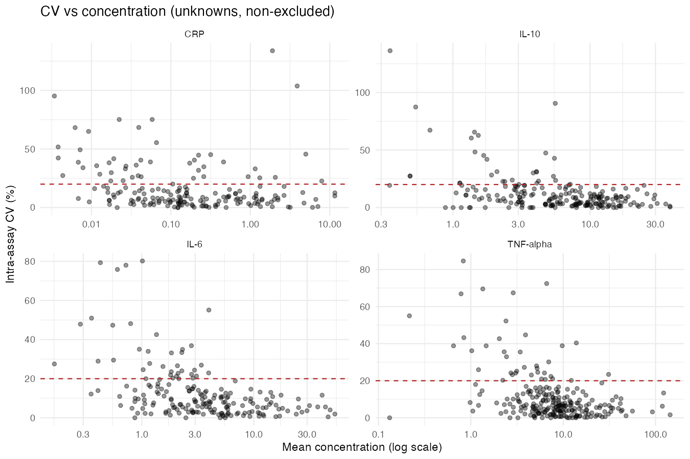
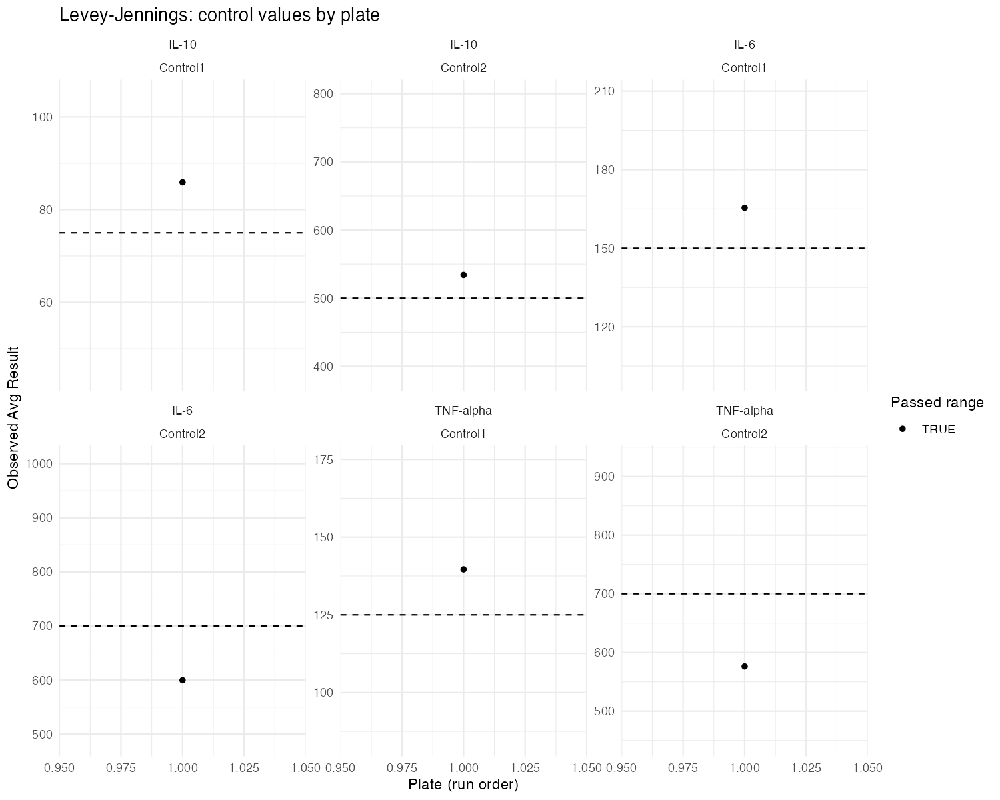

```{r setup, echo=FALSE}
pacman::p_load("dplyr", "tidyr", "readr", "ggplot2", "knitr", "kableExtra")
options(knitr.table.format = "html", scipen = 999)
derived <- "derived"
```

## overview

comes from the **cytokine/CRP panel** (Luminex xPONENT, Millipore Milliplex kits) and the **hormone panel** (Salimetrics ELISA kits: DHEA, testosterone, cortisol, estradiol). workflows compute intra-assay CV (replicate agreement within a plate) and inter-assay CV (plate-to-plate reproducibility of a QC control), but the two panels differ in what could be verified from raw data versus what is carried forward from prior reporting:

| | Cytokines / CRP | Hormones |
|---|---|---|
| **Intra-assay CV** | Recomputed from raw xPONENT export data (this pipeline), on back-calculated concentration | Adopted from prior reporting -- since confirmed to match a from-scratch recompute on raw OD absorbance almost exactly (see [OG vs. Recomputed]) |
| **Inter-assay CV** | Attempted from raw data; **not computable** for most analytes (see below) | Recomputed from raw per-plate control data (this pipeline) -- corrects a mislabeling in the prior reported values |

Numbers labeled "recomputed" below were derived directly from the raw instrument exports by the `cv-pipeline/` R code in this repository (`01_run_characterize.R`, `02_run_clean.R`, `03_run_cv.R`, `04_hormone_inter_cv.R`, `05_og_comparison.R`); numbers labeled "adopted" are carried forward from earlier reporting. A recurring theme below: several of the earlier reported values turn out to have been computed on the **raw instrument signal** (OD for ELISA, MFI for Luminex) rather than the back-calculated concentration this pipeline uses by default -- see [OG vs. Recomputed] for the full comparison.

## Data & Methods

**Cytokines/CRP**: parsed directly from the raw Luminex xPONENT exports (`Human_cytokine_rawdata.xlsx`, `human_cvd_panel_crp_raw_data.xlsx`). Pipeline stages: `characterize()` (per-plate QC — standard curve health, control performance, quantifiability), `tidy_wells()`/`tidy_samples()` (cleaned long-format tables), then intra-/inter-assay CV calculation. All 15 raw plate sheets parse successfully.

**Hormones**: the inter-assay CV was computed directly from the `<hormone> inter-assay CV` sheets in the Masterfile workbook, which are already organized as one control-well block (`CtrlH`/`CtrlL`, high/low QC pool) per plate -- CV is the plate-to-plate SD/mean of each control's per-plate mean, the same definition used for cytokines/CRP.

**Key methodological decisions**, carried through both workflows:

- **Fake-zero exclusion**: when both replicates of a sample are censored (below the lowest standard), xPONENT reports `%CV Replicates` as exactly 0.00 -- not real agreement, just nothing to compare. These pairs are excluded from intra-assay CV, not counted as 0%.
- **`Invalid(x)` handling**: per an explicit decision, the value inside an `Invalid()` wrapper is trusted when otherwise quantifiable (the operator's manual flag no longer blocks the measurement). The one exception is `Avg Result`'s `Invalid(0)`, which is a computational sentinel emitted whenever an average can't be computed with an invalidated replicate, not a real zero -- that specific pattern is still excluded.
- **Below-LLOQ imputation**: in the analysis-ready dataset (not the CV calculations), values below the lower limit of quantification are imputed at the documented assay-protocol LLOD (hormones) or LLOD/2 (cytokines/CRP, per Millipore Milliplex convention), matching prior published methods for this study. CV calculations continue to exclude these as censored rather than using the imputed value, since imputing both replicates of a censored pair to the same constant would recreate the fake-zero artifact.

```{r load-data}
cv_summary <- read_csv(file.path(derived, "cv_summary.csv"), show_col_types = FALSE)
hormone_inter <- read_csv(file.path(derived, "hormone_inter_cv_summary.csv"), show_col_types = FALSE)
og_inter <- read_csv(file.path(derived, "og_cytokine_inter_assay.csv"), show_col_types = FALSE)
cytokine_intra_comp <- read_csv(file.path(derived, "cytokine_intra_basis_comparison.csv"), show_col_types = FALSE)
hormone_intra_comp <- read_csv(file.path(derived, "hormone_intra_basis_comparison.csv"), show_col_types = FALSE)
```

## Data-Quality Findings

Findings from actually parsing the raw files, in the order they matter for interpreting the numbers below:

1. **`Human cytokine raw data - Copy.xlsx` excluded** -- duplicates the same `plt1`-`plt8` sheets already in `Human_cytokine_rawdata.xlsx`; including both would double-count 8 plates.
2. **Precomputed summary sheets skipped** (`Average_Concentrations`, `Raw_Concentrations`, `Inter-Assays`, `Raw_with_undetected_imputed`) -- everything below is computed fresh from raw per-well data, never read off a summary tab.
3. **A real parser bug briefly excluded 2 plates (cytokine and CRP `plt7`), now fixed.** The ID-mapping block's name turned out not to be any fixed string -- confirmed variants across this dataset: `Deducing IDs`, `Deducing Sample IDs` (sometimes reused verbatim for both the paired and deduplicated forms instead of getting a distinct `Single` suffix), and `Detecting Sample IDs`. The parser originally only recognized the first two, so `plt7` fell through to a positional-inference fallback that couldn't complete (raising a loud, honest error rather than silently mis-assigning results -- by design) and both plates were excluded. Fixed by detecting the block **structurally** instead of by name: any row after the sheet's CRC checksum that isn't itself an `UnknownN` row but is immediately followed by one is a block header, whatever it's actually called. All 15 sheets now parse, and a cross-check against every previously-"successful" sheet confirmed the bug never silently corrupted any of them -- it only ever produced hard failures, never wrong-but-quiet results.

    With the real mapping block available, `Median`'s `TAG309 3i` turned out to be a genuine duplicate even in the authoritative source (two different `UnknownN` slots both resolve to that exact label) -- not a disambiguation the parser could have recovered by trying harder. But because the fix restores the *rest* of each plate's mapping, this is now handled at the single-sample level: `TAG309 3i`'s 4 wells (on both panels) are flagged (`duplicate_id_conflict = TRUE`) and excluded from CV calculations, while the other 39 participants on each plate are retained -- rather than losing 2 entire plates over 1 sample.
4. **Two malformed participant IDs recovered**: `TAG0193i` -> `TAG019`/timepoint 3/`i`, and `4iTAG238` -> `TAG238`/timepoint 4/`i` (reversed field order). Both recoveries are flagged in the pipeline logs for verification, not applied silently.
5. **Cytokine/CRP inter-assay CV is not computable from available data**: only 1 of 8 cytokine plates (`plt1`) has control wells at all, and the CRP workbook has no plate with controls (no `plt1` sheet exists for CRP). A standards-based proxy is reported below as a rough indicator only -- see caveat in [Inter-Assay CV].
6. **CRP's previously-reported intra-assay CV (9.08%) traced**: it came from a derived, LLOD/2-imputed dataset (`Raw_with_undetected_imputed`) that also included a CRP "plate 1" no longer present in the raw files available for this analysis. The recomputed value here (see below) uses the true raw, non-imputed data across all 7 CRP plates that could be parsed (plate 1 itself remains unrecoverable -- it's not in the raw workbook at all, independent of the parser fix in finding 3 above).
7. **Hormones' previously-reported "inter-assay CV" (Testosterone 2.06%, DHEA 0.97%, Cortisol 2.03%) traced**: these values matched almost exactly (within 0.01-0.03 points) the average of the *within-plate* OD-based replicate CV (the sheet's own `450 CV (%)` column, averaged across controls and plates) -- a within-run precision statistic, not a between-run one, regardless of how many plates' values are averaged together. Relabeled and properly recomputed below.
8. **CV convention was signal-based, not concentration-based, more broadly**: the same pattern found in (7) also explains most of the hormone *intra*-assay gap and part of the cytokine intra-assay gap -- recomputing on raw OD (hormones) or Net MFI (cytokines) instead of back-calculated concentration closes most of the remaining discrepancies against previously-reported values. Full comparison in [OG vs. Recomputed].

## Intra-Assay CV

```{r intra-table}
cytokine_intra <- cv_summary |>
  filter(cv_type == "intra", level == "unknown") |>
  transmute(
    Panel = "Cytokines/CRP",
    Analyte = analyte,
    Source = "Recomputed (raw data)",
    n,
    `Mean CV (%)` = round(mean_cv, 1),
    `Median CV (%)` = round(median_cv, 1),
    `Mean Concentration` = round(mean_conc, 2),
    Units = units
  )

hormone_intra <- tibble(
  Panel = "Hormones",
  Analyte = c("Testosterone", "DHEA", "Cortisol"),
  Source = "Adopted (confirmed via raw-OD recompute, see OG vs. Recomputed)",
  n = NA_integer_,
  `Mean CV (%)` = c(1.79, 1.58, 2.26),
  `Median CV (%)` = NA_real_,
  `Mean Concentration` = NA_real_,
  Units = NA_character_
)

intra_all <- bind_rows(cytokine_intra, hormone_intra)

intra_all |>
  kable(caption = "Intra-assay CV by analyte. Cytokine/CRP values pool all replicate pairs (unknowns only) across every successfully-parsed plate, excluding fake-zero/censored/invalidated pairs. Hormone values are as previously reported.") |>
  kable_styling(bootstrap_options = "hover", full_width = FALSE) |>
  pack_rows(index = table(intra_all$Panel)[unique(intra_all$Panel)])
```

```{r intra-plot, fig.width=8, fig.height=5}
intra_plot_dat <- intra_all |>
  filter(!is.na(`Mean CV (%)`)) |>
  mutate(Analyte = factor(Analyte, levels = Analyte[order(Panel, -`Mean CV (%)`)]))

ggplot(intra_plot_dat, aes(x = `Mean CV (%)`, y = Analyte, fill = Panel)) +
  geom_col(width = 0.6) +
  geom_vline(xintercept = 10, linetype = "dashed", color = "grey40") +
  geom_text(aes(label = sprintf("%.1f%%", `Mean CV (%)`)), hjust = -0.15, size = 3.5) +
  scale_fill_manual(values = c("Cytokines/CRP" = "#2a78d6", "Hormones" = "#eb6834")) +
  scale_x_continuous(expand = expansion(mult = c(0, 0.15))) +
  labs(x = "Mean intra-assay CV (%)", y = NULL, fill = NULL,
       title = "Intra-assay CV by analyte",
       subtitle = "Dashed line = conventional 10% kit-ELISA threshold") +
  theme_minimal(base_size = 12) +
  theme(legend.position = "bottom")
```

Every cytokine/CRP analyte exceeds the conventional 10% kit-ELISA intra-assay threshold once fake-zero artifacts are properly excluded (~11-15%); all three hormones are well under it. Regulated ligand-binding assay guidance allows up to 20% (25% at the LLOQ) -- none of these values fail that more permissive standard.

## Inter-Assay CV

::: {.callout-warning}
**Cytokines and CRP have essentially no inter-assay data.** Only 1 of 8 cytokine plates has control wells, and the CRP workbook has none at all. The "proxy" values below substitute Standard1-6 `Avg Result` across plates for a true QC-pool measurement -- standards are often reconstituted once per box and reused across several same-day plates, so this systematically **understates** true day-to-day variability. Treat as a rough lower bound, not a validated inter-assay CV.
:::

```{r inter-table}
cytokine_inter_true <- cv_summary |>
  filter(cv_type == "inter", grepl("^average", level)) |>
  transmute(Panel = "Cytokines/CRP", Analyte = analyte, Metric = "True (control-based)",
            n_plates = n, `CV (%)` = round(mean_cv, 1))

cytokine_inter_proxy <- cv_summary |>
  filter(cv_type == "inter_proxy", grepl("^average", level)) |>
  transmute(Panel = "Cytokines/CRP", Analyte = analyte, Metric = "Standards proxy (NOT validated)",
            n_plates = n, `CV (%)` = round(mean_cv, 1))

hormone_inter_tbl <- hormone_inter |>
  filter(plate_set == "excluding_shared_or_redo_plates" | (hormone == "Estradiol" & plate_set == "all_plates")) |>
  transmute(Panel = "Hormones", Analyte = hormone, Metric = paste0("True (", control_level, ")"),
            n_plates = n_plates, `CV (%)` = round(cv, 1))

inter_all <- bind_rows(cytokine_inter_true, cytokine_inter_proxy, hormone_inter_tbl)

inter_all |>
  kable(caption = "Inter-assay CV by analyte. Cytokine/CRP 'true' rows show n_plates=1 or fewer where the metric is not really computable. Hormone values exclude plates shared with other studies and reruns (Estradiol has no unshared plate, so all 3 available plates are shown).") |>
  kable_styling(bootstrap_options = "hover", full_width = FALSE) |>
  pack_rows(index = table(inter_all$Panel)[unique(inter_all$Panel)])
```

Hormone controls show the same pattern seen throughout this data: the low-concentration control (`CtrlL`) is consistently less reproducible than the high control (`CtrlH`) -- e.g. DHEA 8.1% (`CtrlH`) vs. 21.3% (`CtrlL`) -- reflecting greater measurement noise near the assay floor rather than a flaw in the hormone with the higher CV.

## OG vs. Recomputed

Both tables above differ from previously-reported ("OG") values. Digging into how the OG numbers were actually computed resolved almost all of it: **original CV convention was based on the raw instrument signal (OD absorbance for ELISA, MFI for Luminex), not on the back-calculated concentration** this pipeline uses by default. Concentration is the more scientifically relevant basis for interpreting precision of the concentrations actually used downstream, but it is a different, not directly comparable quantity from the historical figures -- this section reconciles the two.

### Hormones: intra-assay CV — fully resolved

```{r hormone-intra-comparison}
hormone_intra_comp |>
  transmute(Hormone = hormone, n, `OD-based (recomputed)` = od_based_cv,
            `Concentration-based (recomputed)` = concentration_based_cv,
            `Adopted (prior reporting)` = adopted_cv) |>
  kable(caption = "Hormone intra-assay CV: recomputed on raw OD vs. concentration, vs. the previously-reported values.") |>
  kable_styling(bootstrap_options = "hover", full_width = FALSE)
```

OD-based recomputation matches the adopted values almost exactly (DHEA 1.58% vs. 1.58%; Testosterone 1.80% vs. 1.79%; Cortisol 2.29% vs. 2.26%) -- this **confirms** the adopted hormone intra-assay CVs and confirms they were computed on absorbance, not concentration. The concentration-based numbers (7.5-9.1%) are the more relevant figures for interpreting the precision of the reported hormone *concentrations* specifically.

### Cytokines/CRP: intra-assay CV — partially resolved

```{r cytokine-intra-comparison}
cytokine_intra_comp |>
  transmute(Analyte = analyte, n, `Result-based (recomputed)` = result_based_cv,
            `Net MFI-based (recomputed)` = net_mfi_based_cv,
            `OG (prior reporting)` = og_intra_cv) |>
  kable(caption = "Cytokine/CRP intra-assay CV: recomputed on Result (concentration) vs. Net MFI, vs. the previously-reported ('OG') values.") |>
  kable_styling(bootstrap_options = "hover", full_width = FALSE)
```

Mixed picture: TNF-α (Net MFI 10.7% vs. OG 10.4%) lands close to OG once computed on Net MFI instead of Result (11.0%) -- consistent with the same signal-based convention seen in hormones. IL-6 shows the same direction (Net MFI 9.4% vs. Result 11.3%, OG 9.9%) -- MFI is the closer basis there too. IL-10 is more mixed: neither basis matches OG (12.3%) as closely as before revisiting the plate count -- Result (11.0%) is somewhat closer than Net MFI (9.7%), but neither is a tight match. CRP doesn't resolve either way (Result 14.9% / Net MFI 13.2% vs. OG 9.1%) -- its gap has a separate, already-identified cause (the OG value came from an LLOD/2-imputed dataset that also included a now-missing plate 1, not a signal-basis difference). Net MFI is not a substitute for the concentration-based numbers in the main table above -- it's reported here only to explain the historical gap.

### Cytokines/CRP: inter-assay CV — the OG values themselves, for reference

```{r og-inter-table}
og_inter |>
  kable(caption = "The lab's own 'Inter-assay:' calculation, read directly from the Inter-assays/Inter-Assays summary sheets. Built from the highest + lowest STANDARD across all 8 plates (there being no real repeated QC control on most plates) -- the same workaround this pipeline's 'standards proxy' independently arrived at.") |>
  kable_styling(bootstrap_options = "hover", full_width = FALSE)
```

IL-10's OG value (2.06%) lands close to this pipeline's standards-based proxy (2.0%) -- reassuring, since two independently-built workarounds roughly agree. IL-6 and CRP were left **blank** in the original file -- the summary formula cells are simply empty, meaning the original analysts hit the same data gap this pipeline did, not something specific to how this pipeline handles it. TNF-α's OG value (103%) is not usable at all: it's dominated by one wildly outlying plate (Plate 6's low-standard replicates read ~110-134 vs. ~3-20 everywhere else) averaged in without exclusion, not a real precision estimate.

## Diagnostic Plots

### CV vs. Concentration (Cytokines/CRP)

Confirms the concentration-dependence pattern driving the intra-assay CV numbers above -- CV is worst near the LLOQ and tightens at higher concentrations.



### Levey-Jennings: Control Values by Plate (Cytokines/CRP)

Visual confirmation of the "essentially no inter-assay data" finding -- most panels here show a single point, because only one plate has a control well for that level.



## Limitations

- **Concentration-based and signal-based (OD/MFI) CV are both legitimate, but not interchangeable.** This report leads with concentration-based numbers as primary (they describe the precision of what's actually used downstream), and uses the signal-based recompute only to explain gaps against historical figures. A reader citing a single CV per analyte should be explicit about which basis it is -- see [OG vs. Recomputed].
- **CRP's intra-assay gap is not explained by signal basis.** Unlike the other analytes, neither Result- nor Net-MFI-based recomputation closes the gap to the OG 9.08% value -- that figure's cause (an LLOD/2-imputed dataset including a now-missing plate 1) is a separate, already-identified issue.
- **Cytokine/CRP inter-assay CV is a genuine data gap, not a pipeline limitation.** No amount of reanalysis recovers a metric that needs repeated control measurements the source plates don't have -- confirmed by the original analysts leaving the same cells blank in their own summary sheet.
- **Estradiol's inter-assay CV** is based on only 3 plates, all either shared with another study or a rerun -- there is no "clean" Estradiol plate in this dataset at all.
- **Thresholds cited** (10% intra, 15% inter) are conventional kit-ELISA conventions, not a regulatory requirement; regulated ligand-binding assay guidance (FDA/EMA bioanalytical method validation) allows up to 20% (25% at the LLOQ).

## Appendix: Full Detail Reports

- [`characterization_report.md`](derived/characterization_report.md) -- per-plate QC detail (standard curve health, control performance, quantifiability) for every cytokine/CRP plate
- [`cv_report.md`](derived/cv_report.md) -- full cytokine/CRP CV report, including exclusions, the parser-correctness check, and per-tertile concentration stratification
- [`hormone_inter_cv_report.md`](derived/hormone_inter_cv_report.md) -- full per-plate hormone control detail
- Underlying data: `derived/wells_tidy.csv`, `derived/samples_tidy.csv`, `derived/cv_summary.csv`, `derived/hormone_inter_cv_blocks.csv`, `derived/hormone_inter_cv_summary.csv`, `derived/og_cytokine_inter_assay.csv`, `derived/cytokine_intra_basis_comparison.csv`, `derived/hormone_intra_basis_comparison.csv`
